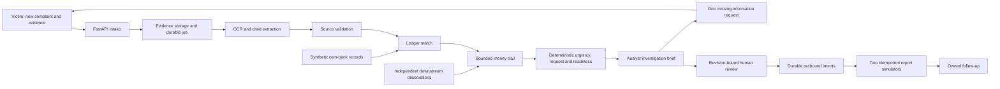
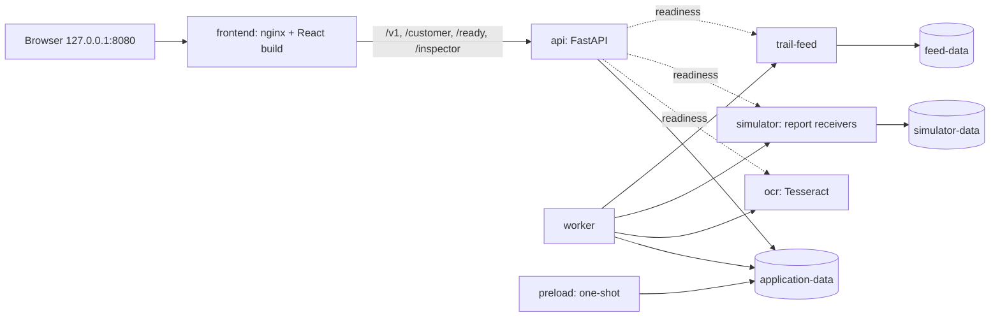

# Architecture

The primary user is a bank payment-scam response analyst. The victim interface is
a bank reporting and clarification channel. Synthetic demonstration identities
and records are explicitly labeled throughout.

The brief contains payment inventory, chronology, citations, conflicts, unknowns,
recommended action and review rationale. Victim statements, own-bank records and
downstream observations preserve separate provenance and observation times.
Unknown or stale data cannot silently become verified. Unsupported urgent action
and a complete handoff have distinct eligibility rules.

Approvals bind to a case revision and digest. New material invalidates stale
approval; prior decisions remain in history. Durable jobs and outbound intents
survive retries, lease loss and lost acknowledgements. Receivers deduplicate by
idempotency key. A delivered packet remains open for follow-up.

## Local packaging

`compose.yaml` runs independent services on one user-defined network, `caseproof`.
Services address each other by Compose DNS name; only `frontend` publishes a port,
bound to host loopback.

- `frontend` (`frontend/Dockerfile`) builds the React app with pinned Node and serves
  it from nginx at `/app/`. Every other path is reverse-proxied to `api:8000`.
- Backend images come from the multi-target root `Dockerfile`: `service` (API,
  worker, preload, feed, simulator) and `ocr` (adds Tesseract; Bookworm keeps the
  frozen local OCR baseline). The default `test` target is the regression image.
- `api` readiness (`/ready`) requires OCR, feed, simulator and a fresh worker
  heartbeat; `frontend` starts only after `api` is healthy. `preload` must finish
  successfully before `api` and `worker` start. Each service restarts independently.
- `api` and `worker` share the case store (SQLite + DuckDB + objects) on the
  `application-data` volume, standing in for Firestore/BigQuery/Cloud Storage.
  The feed and simulator own their data on separate volumes.
- The worker keeps a small pool of pre-built practice worlds so a new practice
  session is claimed rather than generated on request (`PRACTICE_POOL_SIZE`).

## Google target

Use separately deployed services and attached identities for frontend, API, worker,
scanner and simulators. The load balancer routes `/v1/*` and `/health` to the API and
everything else to the frontend (built with `FRONTEND_PROFILE=cloud`, which proxies
nothing and only redirects `/customer/{token}` to the React reply route). Google mode rejects silent local-storage/OCR/model fallbacks.
Cloud Armor protects edge requests; a private malware scanner separately gates
quarantine promotion. See `infra/google/README.md`. Local packaging changes do
not authorize Terraform apply, image publication or deployment.
